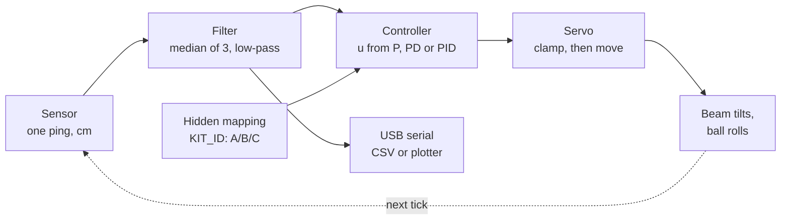

# Mystery Controller: how it works (instructor document)

> **Instructor only.** This document, `mystery_controller.ino`, `kit_mapping.csv`, `sim_rig.py` and `sim_traces.png` reveal or help reveal the answers. Keep them out of the student repository until the reveal. Students get `STUDENT_GUIDE.md` and `ball_logger.py` only.

The kit runs three hidden controllers (P, PD and PID) behind the letters A, B and C. Students select them over the existing USB cable, identify them from experiments and saved plots, and only see the source code at the end.

**No extra electronics.** The challenge uses the working balance rig unchanged: Arduino Nano Every, HC-SR04, servo, USB cable and a laptop. The only extra item is a small removable shim (a spacer) for the tilt experiment. The normal balance sketch is not modified; the challenge is a separate sketch, and re-flashing the balance sketch restores normal mode.

---

## 0. Evidence status

Every quantitative claim in this document carries one of these labels.

| Label | Meaning |
|---|---|
| **[MEASURED]** | taken from the physical rig (source given) |
| **[CALC]** | worked out by hand from stated values |
| **[SIM]** | from `sim_rig.py`, a model of the rig, not hardware |
| **[PENDING]** | must be checked on the bench before the session |

| Item | Status |
|---|---|
| Level angle 104°, `DIRECTION = +1` | [MEASURED] on the aluminium-rail build, beam checked level |
| K ≈ 1.69 cm/s² per servo degree (c ≈ 0.50) | [MEASURED] one data point: ~50 cm/s² deceleration at 30° servo tilt on aluminium rails with the ping-pong ball. **Re-measure on the current rails and ball with `calibrate`.** |
| Servo limits 74–134° | [PENDING] currently "level ± 30", not yet checked for linkage binding |
| 65 ms tick, loop jitter, outlier rate | [PENDING] log `dt_ms` and inspect raw readings on the rig |
| Gains Kp 1.3, Kd 1.4, Ki 0.3 | [CALC] from the measured K; [PENDING] confirm the three signatures on the rig |
| All response numbers in section 9 | [SIM] |
| Firmware compiles | checked with a desktop C++ compiler and stand-in Arduino functions; [PENDING] Verify in the Arduino IDE |
| Logger and firmware serial protocol | tested end to end against an emulated board (all five tests, calibration and summary); [PENDING] on the real kit |

---

## 1. Files and who sees them

| File | Audience | Purpose |
|---|---|---|
| `mystery_controller.ino` | instructor (revealed at end) | challenge firmware, the answer key |
| `kit_mapping.csv` | instructor only | letter → law for kits 1–30 |
| `HOW_IT_WORKS.md` | instructor only | this document |
| `sim_rig.py`, `sim_traces.png`, `sim_output.txt` | instructor only | reproducible predictions |
| `STUDENT_GUIDE.md` | students | procedures, worksheet, scoring |
| `ball_logger.py` | students | menu to run tests, save CSV and plots, summarise |
| kit card (printed) | students | kit number, Kp, G |

The student guide deliberately does **not** list which behaviour belongs to which controller. It gives procedures and prediction questions; the signatures are for students to discover.

---

## 2. Symbols and units

| Symbol | Meaning | Units |
|---|---|---|
| x | ball position, measured from the sensor face | cm |
| target | beam centre, fixed at 15 cm | cm |
| d | displacement from centre = x − target (+ = away from the sensor) | cm |
| e | error = target − x = −d | cm |
| v | ball velocity = dx/dt (filtered) | cm/s |
| ∫e | integral of error over time | cm·s |
| u | controller output: servo degrees from level | deg (servo) |
| θ | beam angle | rad, or deg (beam) |
| G | linkage gain: beam degrees per servo degree | 0.198 |
| Kp | proportional gain | servo deg per cm |
| Kd | derivative gain | servo deg per (cm/s) = servo deg·s/cm |
| Ki | integral gain | servo deg per (cm·s) |
| K | plant gain: x″ = K·u | cm/s² per servo deg |
| c | rolling factor: a = c·g·sin θ | — |
| dt | measured time between ticks (nominal 65 ms) | s |

To convert a gain to beam terms, multiply by G (and by π/180 for radians).

---

## 3. One tick of the loop



1. **Measure dt.** The board times the gap since the last tick with `micros()` and uses that measured dt (bounded to 0.5–2× nominal) for velocity and the integral. dt is logged in every CSV row.
2. **Sensor.** One HC-SR04 ping. Readings outside 2–28.5 cm are discarded.
3. **Filter.** Median of the last three readings (removes one-off spikes), then 60/40 low-pass. Velocity = change in filtered position ÷ dt, then 50/50 low-pass. All three controllers get identical filtering.
4. **Controller.** Computes u (section 5), clamps it to ±30°.
5. **Servo.** Angle = 104° + DIRECTION·u, then clamped to the calibrated servo limits. The tilt actually sent is what gets logged.
6. **Output.** CSV: `t_s, dt_ms, letter, running, event, ball_cm, target_cm, tilt_deg`. `t_s` is board time since START. `event` = 1 on the row after an `m` command (ball released). Nothing in the output reveals the law or gains.

### Timing

The HC-SR04 datasheet recommends a measurement cycle over 60 ms; faster, and a late echo from the previous ping (for example off End Block B) can be read as the ball. That is a likely cause of the ~29.5 cm readings and 5–6 cm jumps in earlier logs. The tick is therefore **65 ms (~15 Hz)**, one ping per tick.

- The echo timeout is 20 ms, so a missed echo costs at most 20 ms of the 65 ms tick. A 3 ms timeout tried earlier returned no readings at all, because `pulseIn` also counts the sensor's start-up delay before the echo pin rises.
- If the loop ever falls more than a tick behind, the scheduler resyncs instead of running a burst of catch-up ticks.
- **[PENDING]** Check on the rig: run a test, then look at `dt_ms` (the logger reports mean, max and % late) and at the raw readings for outliers. If the working balance sketch has a sensing method that has proven reliable, paste it into `readRawCm()` and keep everything else.

Filtering adds delay, which costs damping. The gains below assume roughly 0.15–0.2 s of total loop delay [CALC, rough]; if the rig is noticeably less damped than predicted, raise Kd slightly or reduce `POS_ALPHA` filtering.

---

## 4. Servo calibration [PENDING on each kit]

Firmware constants: `LEVEL_ANGLE`, `DIRECTION`, `SERVO_MIN_DEG`, `SERVO_MAX_DEG`.

1. **Level angle.** Flash the balance sketch (or any sketch that writes a fixed angle). Step the servo angle until a spirit level on the rails reads level. Record it. Current value: 104° [MEASURED].
2. **Direction.** Increase the servo angle by 10°. If the ball rolls away from the sensor, `DIRECTION = +1`; otherwise −1. Current: +1 [MEASURED].
3. **Safe limits.** With the ball removed, step the angle slowly each way from level until the linkage nears binding, the beam touches the base, or the servo strains. Back off 3°. Record both limits; they need not be symmetric about level.
4. Enter the values and re-flash.

The firmware clamps twice: the controller output to ±30°, and then the final servo angle to [SERVO_MIN_DEG, SERVO_MAX_DEG]. The servo limits always win, even if they are asymmetric.

---

## 5. The three controllers

```
u = Kp·e − Kd·v + Ki·∫e        (then clamped)
```

| Letter shows | Terms used |
|---|---|
| P | Kp·e |
| PD | Kp·e − Kd·v |
| PID | Kp·e − Kd·v + Ki·∫e |

Kp is identical in all three, so any difference between letters is caused only by adding D, then I.

### Gains and how they were chosen [CALC]

With x″ = K·u and PD control u = −Kp·d − Kd·v:

```
x″ + K·Kd·x′ + K·Kp·x = 0     →   ωn² = K·Kp,   2ζωn = K·Kd
```

| Gain | Value | Units | Design |
|---|---|---|---|
| Kp | 1.3 | servo deg/cm | ωn = 1.5 rad/s: Kp = ωn²/K = 2.25/1.69 = 1.33 |
| Kd | 1.4 | servo deg·s/cm | ζ = 0.8: Kd = 2ζωn/K = 2.4/1.69 = 1.42 |
| Ki | 0.3 | servo deg/(cm·s) | ≈ 0.23 × Kp; slow enough to watch the creep |

After rounding: ωn = √(1.69 × 1.3) = 1.48 rad/s, ζ = 1.69 × 1.4 / (2 × 1.48) = 0.80.

PID characteristic equation (no delay): s³ + K·Kd·s² + K·Kp·s + K·Ki = 0. Routh stability needs (K·Kd)(K·Kp) > K·Ki: 2.37 × 2.20 = 5.2 > 0.51, so it is stable with a wide margin.

**Kp/Ki ≈ 4.3 s** is a rough characteristic time scale for the integral to remove an offset, not the exact closed-loop time constant.

If K changes (new rails or ball), recompute Kp and Kd from the formulas, or copy them from the tuned balance sketch, and keep Ki ≈ 0.23 × Kp. Then re-run `sim_rig.py` and the bench checks.

### Signs and servo direction

- e > 0: ball too close to the sensor. u > 0: ball rolls away from the sensor.
- Positive error → positive tilt → ball pushed towards the centre, and vice versa.
- Symptom of a wrong `DIRECTION`: the ball runs to an end stop and stays there.

### The derivative term

With a fixed target, de/dt = d(target − x)/dt = **−v**. The textbook term Kd·de/dt is therefore −Kd·v, which is what the code computes (*derivative on measurement*). The negative sign is what makes it oppose motion: ball moving away from the sensor (v > 0) reduces the tilt, ball moving towards it (v < 0) increases the tilt, so either way it is slowed.

Using v rather than de/dt avoids a derivative kick if the *target* changes. It does not prevent u jumping if the *gains* change while the ball moves; the firmware never changes gains at runtime.

The cost is noise: v divides a small, noisy position change by a short dt, so jitter appears as velocity and Kd amplifies it.

### Saturation, the integral cap and bounded wind-up

- **Output clamp:** ±30 servo deg (≈ ±6° of beam), then the calibrated servo limits.
- **Integral cap:** the I *contribution* Ki·∫e is limited to ±20°. This bounds how much wind-up can be stored, but it is **not full anti-windup**: the integral keeps accumulating (up to its cap) even while the total output is clamped, and the cap does not stop the total from saturating. This is deliberate, so that **bounded wind-up** is visible in experiment 3.
- When Kp·e + Ki·∫e − Kd·v exceeds 30°, the beam simply sits at full tilt; the controller cannot push harder, so recovery takes longer.
- **Hold test load** [CALC]: holding the ball 8 cm off-centre gives a P term of 1.3 × 8 = 10.4° plus an I term growing at 0.3 × 8 = 2.4°/s. After 5 s the total is about 22°, below the 30° clamp. The servo is never stalled: students hold the ball, not the beam, so the beam moves freely.
- If the output stays at the clamp for 8 s, the firmware stops and levels the beam (protects against a forgotten held ball).

### State rules

| Event | Result |
|---|---|
| Power-up or board reset | stopped, letter A, beam level |
| Select a/b/c | stop, clear integral and filters, beam level |
| `g` (START) | clean restart: integral, velocity filter and timer reset |
| `x` (STOP) | controller off, integral cleared, beam level |
| Sensor lost for 0.6 s | automatic STOP, message `# Stopped: lost the ball reading.` |
| Output clamped for 8 s | automatic STOP, message printed |
| `k` (calibration) | controller off, fixed +10° servo tilt, stops at far end or after 4 s |
| USB port opened | some boards reset when the port opens; either way the logger waits 2 s, then sends `x` and `l`, so the state is explicit |

Only one program can open the kit's USB port at a time. Students must close the Arduino Serial Monitor and Plotter before running the logger, and vice versa.

---

## 6. Physics and the hand calculation

### Ideal model (the textbook result) [CALC]

A solid ball of mass m and radius R rolling without slipping down a beam at angle θ:

```
kinetic energy = ½mv² + ½(⅖mR²)(v/R)² = (7/10)mv²
m·g·sin θ = (7/5)·m·a   →   a = (5/7)·g·sin θ ≈ (5/7)·g·θ   (θ small, in rad)
```

Under P control with beam angle θ = −Kp,beam·d (Kp,beam in rad/m):

```
d″ = −(5/7)·g·Kp,beam·d   →   ω = √((5/7)·g·Kp,beam),   T = 2π/ω
```

### The real rig

Three things change:

1. **Units.** The firmware's Kp is in *servo* degrees per *cm*. Beam angle in rad = G·(π/180)·u, so Kp,beam = G·(π/180)·Kp (rad per cm) and g = 981 cm/s².
2. **Contact geometry.** On two rails the ball rolls on a radius r smaller than R, and a hollow ping-pong ball has I = ⅔mR². Both raise the rotational share, so c = 1 / (1 + I/(m·r²)) is below 5/7.
3. **Empirical constant.** Combine everything into K = c·g·G·(π/180), measured directly with the `calibrate` routine.

```
d″ = −K·Kp·d   →   ω = √(K·Kp),   T = 2π/√(K·Kp)
```

| Case | c | K (cm/s² per servo deg) | T for Kp = 1.3 |
|---|---|---|---|
| Ideal solid ball, flat track | 5/7 = 0.714 | 2.42 | 3.54 s [CALC] |
| Measured, ping-pong ball, aluminium rails | ≈ 0.50 | 1.69 | 4.23 s [CALC from MEASURED K] |

Using 5/7 instead of the measured 0.50 predicts a period about **16% too short** (3.54 vs 4.23 s). For a solid golf ball on rails, c is typically around 0.55–0.65 depending on rail spacing [CALC, geometry not yet measured].

**K must be re-measured** whenever the rails or ball change. K ≈ 1.69 was measured on aluminium rails with a ping-pong ball and must not be carried over to wooden rails or a golf ball.

### Measuring K (`calibrate`)

1. Kit stopped, beam level, ball against the near end stop.
2. The logger sends `k`: the controller is off and the beam is held at +10 servo degrees.
3. The ball accelerates away; the logger fits x = x₀ + v₀t + ½at² to the samples between 5 and 24 cm.
4. K = a / 10, c = K / (g·G·π/180). Repeat three times and average.

Run against the simulated rig (true K = 1.69), the routine returned K = 1.63 and c = 0.48, about 4% low because of filter and servo lag at the start of the roll [SIM]. Treat bench values as accurate to roughly ±5%.

### Using it for the P period

Measure the **first** cycle of the `period` test: P controller, ball released 3 cm off-centre. On the rig the oscillation may grow, hold steady or decay depending on loop delay, friction and stiction. In simulation it grows and reaches the end stops by the third cycle, which shortens later cycles, so only the first is compared [SIM].

---

## 7. Experiments and expected signatures

These are the *expected qualitative patterns*. They are [CALC] / [SIM] until confirmed on the bench, and they depend on the gains. In particular, PID does not overshoot more than PD for every possible gain choice, and a real P loop may decay rather than grow.

| Experiment | Setup | P | PD | PID |
|---|---|---|---|---|
| 1. Release from far end stop | level beam, ball against far stop, START | oscillates; does not settle (ideal: constant amplitude; with delay: may grow) | settles at centre | settles at centre; with these gains, more overshoot than PD |
| 2. Shim | shim under base, ball at centre, START | oscillates about an offset position | stops off-centre and stays (steady-state error) | stops off-centre, then creeps back to centre |
| 3a. Baseline release from 23 cm mark | ball held on mark, START and release together | oscillates | settles | settles; modest overshoot |
| 3b. Hold 5 s on 23 cm mark, then release | START, hold, release at cue | oscillates | ≈ same as 3a | clearly more overshoot than 3a (stored integral) |
| Bonus: jitter at rest | — | least servo twitching | more | more |

### Shim offset [CALC]

A shim of height h under one end of a base whose supports are L_base apart tilts the rig by

```
δ ≈ (h / L_base)·(180/π)   beam degrees  =  δ/G   servo degrees
```

At rest (v = 0) PD can only produce Kp·e, so it stops where Kp·e cancels the shim:

```
PD offset = δ / (G·Kp)
```

Example: h = 3.5 mm, L_base = 200 mm → δ ≈ 1.0° → 5.1 servo deg → offset ≈ 3.9 cm. PID removes this offset because the integral grows until Ki·∫e supplies the 5° itself, provided the loop stays stable and the extra 5° is within the output limits (it is: 5° of 30°).

### Matched wind-up comparison

Experiment 3 compares two runs **from the same mark** (23 cm, i.e. 8 cm past centre):

- **3a baseline:** controller started at the moment of release, integral zero.
- **3b hold:** controller started, ball held on the mark for 5 s (logger countdown), released at the cue.

Same start, same controller; the only difference is 5 s of stored integral. PD has no integral, so 3a ≈ 3b. For PID, 3b − 3a is the wind-up effect. `summary` prints this difference per letter. The release time is the board row tagged `event = 1`, sent by the logger at the cue; human reaction adds ~0.2–0.3 s, which is the same for every controller.

### Repeats

Three trials per test per letter (minimum two). `summary` reports the mean and min–max for every metric.

---

## 8. The logger: definitions

All metrics are computed from board timestamps, starting at the release row (or START if no release row).

| Metric | Definition |
|---|---|
| Start displacement d₀ | d at release |
| Overshoot | furthest excursion on the opposite side of centre after the first crossing (cm), and as % of \|d₀\|. Not reported if \|d₀\| < 1 cm |
| Settling time | time from release until the ball enters ±2 cm and stays there for the rest of the run, with at least 3 s inside at the end. Otherwise "never settled at target" |
| Final mean | signed mean of d over the last 5 s (cm) |
| Final SD, drift | SD of d over the last 5 s; drift = linear trend over that window × 5 s |
| Final state | **settled at target**: still (SD < 0.6 cm, range < 2 cm, drift < 1 cm) and inside ±2 cm. **stationary off-centre**: still but outside ±2 cm (e.g. PD in the shim test). **no steady state**: still moving, oscillating or drifting |
| Period | time between upward crossings of centre, with ±1 cm hysteresis, interpolated; first period reported separately |
| Loop timing | mean and max dt, % of ticks over 1.5 × 65 ms |

"Stationary off-centre" is a valid steady state with nonzero error, not a failure to settle. It is reported by its signed mean, not suppressed.

---

## 9. Predicted results [SIM]

Produced by `python sim_rig.py` (5 noise seeds; ranges are min–max). Full output in `sim_output.txt`, traces in `sim_traces.png`.

**Model assumptions:** x″ = K·(servo tilt + shim) − 0.05·v with K = 1.69; servo first-order lag 50 ms, max 600°/s; sensor noise SD 0.3 cm; tick 65 ± 2 ms; firmware filters, laws, clamps and limits copied exactly; end stops at 2.8 and 27.6 cm, rebound 20%; shim = 5 servo deg (1° beam). Not modelled: stiction, rail imperfections, servo dead-band, echo outliers.

| Test | Law | Overshoot | Settling | Final state (mean) |
|---|---|---|---|---|
| 1 release | P | 11.7–12.1 cm (93–97%) | never | no steady state |
| 1 release | PD | 0.5–0.6 cm (4–5%) | 1.4–1.6 s | settled (0.0 cm) |
| 1 release | PID | 2.2–2.4 cm (18–20%) | 4.3–5.5 s | settled (0.0 cm) |
| 2 shim | PD | — | never | stationary off-centre (+3.8 cm) |
| 2 shim | PID | — | 4.3–5.0 s | settled (0.0 cm) |
| 3a baseline | PD | 0.5–0.7 cm | 1.2–1.3 s | settled |
| 3a baseline | PID | 1.6–1.8 cm | 1.0–1.2 s | settled |
| 3b hold | PD | 0.4–0.6 cm | 1.3 s | settled |
| 3b hold | PID | 8.7–9.1 cm | 8.1–8.4 s | settled |
| period | P | first period 4.31–4.41 s vs 4.24 s predicted | never | no steady state |

Wind-up effect (3b − 3a overshoot): PD ≈ 0 cm, PID ≈ +7 cm [SIM].
Servo jitter at rest, RMS tilt change per tick: P 0.35°, PD 1.45°, PID 1.46° [SIM].


Replace this table with bench data before showing it to anyone as results.

---

## 10. The A/B/C mapping and secrecy

- There are six permutations of P, PD, PID over A, B, C. The firmware uses permutation `(KIT_ID × 5 + 2) mod 6`.
- Consecutive kit numbers never share a mapping, but **mappings repeat every six kits** (kit 1 and kit 7 are identical). Avoid seating groups whose kit numbers differ by a multiple of six next to each other.
- `KIT_ID` is set before flashing and printed on the kit card. `kit_mapping.csv` is the answer key; do not publish worked examples of a kit's mapping.
- Nothing students can see reveals the law: serial output shows only the letter, the `?` status line shows kit/letter/running, and the calibration mode shows "K".
- Between cohorts, re-flash with different KIT_IDs (or change the `+ 2` offset), since earlier cohorts know old mappings.
- A determined student could read the flash memory with programming tools; this is a classroom challenge, not a security boundary.

---

## 11. Assessment

### Scoring (out of 100; also published in the student guide)

| Component | Points | Rule |
|---|---|---|
| Identification | 30 | 10 per correct letter, checked against `kit_mapping.csv` |
| Evidence | 40 | per letter, up to 10 for deciding evidence (named plot + metric that separates it from the other two); plus up to 10 for completeness (required tests × trials with run files, pro rata) |
| Hand calculation | 20 | 8 method and consistent units; 4 measured K and c from `calibrate`; 8 comparison with the measured first period and a reasoned explanation of any difference. Agreement itself is not marked, since K varies between kits |
| Speed | 10 | first group with all three correct: 10, then 2 fewer per later group (minimum 0) |

- A correct letter without evidence earns identification points only.
- Speed points need all three letters correct and at least one trial of each required test.
- Incomplete trials: completeness points pro rata; identification still marked.
- Ties: evidence score, then hand calculation, then submission time. Simultaneous submissions share the speed points.

### Learning-outcome links

**MECH0023 Dynamics and Control**
- Interpreting time-domain responses: overshoot, settling time, steady state from logged traces.
- Roles of P, I and D action: each experiment isolates one term's effect with Kp held fixed.
- Steady-state error: shim test, PD offset = δ/(G·Kp), removed by integral action.
- Damping: P alone cannot damp a double integrator; D supplies damping; delay erodes it.
- Integral wind-up: matched hold vs baseline comparison.
- Modelling: x″ = c·g·θ, unit conversion, comparison of ideal and calibrated predictions.

**MECH0073 capstone fundamentals**
- Sensor data in → filtered, computed metrics out → justified conclusion: the logger turns raw distance readings into overshoot, settling and offset, and students must defend identifications with those numbers.
- Data quality: timestamps, loop jitter, noise and outliers, repeated trials.

### Instructor reveal sequence

1. Collect each group's results sheet and saved `runs` folder; note submission times.
2. Look up each kit in `kit_mapping.csv`; score identification, then evidence and hand calculation.
3. Publish the leaderboard.
4. Reveal: show `computeTilt()` in the firmware, the only place the three letters differ (two `if` blocks).
5. Debrief with `sim_traces.png` next to the groups' plots: where did the model and the rig disagree, and why (friction, delay, K, stiction)?
6. Re-flash kits with new KIT_IDs before the next cohort.

---

## 12. Bench validation checklist (before the session)

- [ ] Balance sketch still balances the ball (re-flash it, run once, re-flash challenge).
- [ ] Servo level, direction and safe limits calibrated and entered (section 4).
- [ ] `calibrate` run 3× on the current rails and ball; K and c recorded; Kp, Kd recomputed if K changed.
- [ ] Loop timing: `dt_ms` mean ≈ 65 ms, few late ticks; no implausible jumps or >28 cm readings in a 60 s log.
- [ ] Each letter on each kit runs the correct law (instructor checks with the mapping).
- [ ] Release, shim and matched hold tests run 3× per letter; the three signatures are repeatably distinguishable. Record which ones are and update section 7.
- [ ] Hold test: servo not straining, auto-stop works if the ball is held too long.
- [ ] Sensor-loss stop works (lift the ball off the beam while running).
- [ ] Section 9 updated with bench numbers alongside the simulation.
- [ ] Shim heights measured and written on each shim; base support spacing measured.
- [ ] Beam marks at 15, 18 and 23 cm from the sensor face checked with a ruler.
